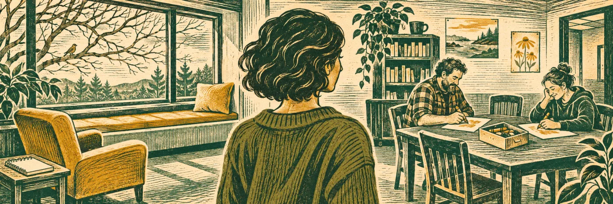

# Brief Psychotherapy on the Unit

> **Review status:** Reviewed and attested by Joshua Moss, MD (2026-07-09). Educational; fictional composites only, no PHI.

**In one line** — You will not complete a course of therapy on an inpatient unit, but almost every encounter is a *micro-intervention*. The skill is to read the mechanism driving this patient's crisis right now and match one brief technique to it — then hand the work off to outpatient care.

**Why brief therapy is worth doing inpatient** — Across trials, inpatient psychotherapy adds a small-to-moderate benefit over treatment-as-usual, and **no single modality is clearly superior** (small-to-moderate pooled effects with no clear winner across modalities — the specific meta-analyses are traced on the Evidence-Based Inpatient Psychiatry page). The practical takeaway is liberating: *stop agonizing over which "school" to use and match the technique to the mechanism in front of you.* Diagnosis and the driver of the crisis matter more than the brand of therapy.

## Match the skill to the mechanism

| What you see | Likely mechanism | Reach for | Why (evidence) |
|---|---|---|---|
| Withdrawn, inactive, anhedonic, "nothing matters" | Behavioral shutdown | **Behavioral activation (BA)** — schedule one small, valued activity | Superior to TAU for depression (SMD −0.78) and anxiety (−0.33), on par with CBT (Uphoff, *Cochrane* 2020 — outpatient trials only; inpatient RCTs were excluded); **lowest cognitive demand → a reasonable inpatient fit by extrapolation** |
| Escalating, flooded, about to act | Acute emotional dysregulation | **DBT skills — TIPP** (temperature, intense exercise, paced breathing, paired relaxation) | Skills-containing DBT arms outperform for self-injury in dismantling trials (Linehan 2015) |
| Just self-harmed or nearly did | Behavior serving a function | **Chain analysis** — walk the sequence *with* the patient, non-punitively | Turns an incident into a formulation and a plan; core DBT move |
| Repeatedly returns in crisis, overwhelmed by problems | Problem-solving deficit | **Problem-solving therapy (PST)** — the 4-step format (define → brainstorm → choose → try) | In the prespecified subgroup presenting with *repeat* self-harm, re-presentation 13.5% vs 22.1%, **NNT 12**; no effect in the trial overall (Hatcher 2011) |
| Ambivalent about meds, treatment, or substance use | Motivational conflict | **Motivational interviewing (MI)** — respond to sustain talk and discord without arguing, evoke change talk | Improves engagement and substance outcomes; see the [Motivational Interviewing](?page=motivational_interviewing.md) page |
| Confused or frightened by the illness itself | Knowledge/coping gap | **Psychoeducation** — illness model + warning-signs plan, include family | Among the best-supported inpatient psychological interventions: relapse **NNT 9**, readmission **NNT 5** — the latter on only 206 participants, in studies the reviewers called limited quality (Xia, *Cochrane* 2011) |
| Actively suicidal | Acute risk state | **Safety planning (Stanley-Brown)** + crisis response planning | Safety Planning Intervention with follow-up was associated with ≈ **45% fewer suicidal behaviors** (Stanley 2018, cohort comparison); **abandon no-suicide "contracts"** — they don't work |

<section class="noor-case" id="noor-dayroom" aria-labelledby="nd-title">
  <header><h3 id="nd-title">What counts as a start?</h3>
Noor is on the unit for depression. She usually heads back to bed after breakfast. Today she stops beside you at the dayroom door.
</header>
  
Noor · Fictional patient<blockquote>“My niece and I draw birds on napkins. Hers look like they’re wearing boots. I was going to draw her one yesterday. Got as far as finding the paper.”</blockquote>

  
MS3 · At the dayroom door

  <h4 id="nd-first">What small step would you offer?</h4>
  
  

    <button type="button" data-place="window" aria-pressed="false" aria-controls="nd-agreement"><strong><svg aria-hidden="true" focusable="false" width="18" height="18" fill="none" stroke="currentColor" stroke-width="1.7" stroke-linecap="round" stroke-linejoin="round"><use href="#ic-sun"></use></svg>The window seat</strong>“Want to sit by the window with me? Sometimes the birds land pretty close.”</button>
    <button type="button" data-place="lap" aria-pressed="false" aria-controls="nd-agreement"><strong><svg aria-hidden="true" focusable="false" width="18" height="18" fill="none" stroke="currentColor" stroke-width="1.7" stroke-linecap="round" stroke-linejoin="round"><use href="#ic-footprints"></use></svg>A lap on the unit</strong>“Feel like walking a lap with me? We can turn back whenever you want.”</button>
    <button type="button" data-place="table" aria-pressed="false" aria-controls="nd-agreement"><strong><svg aria-hidden="true" focusable="false" width="18" height="18" fill="none" stroke="currentColor" stroke-width="1.7" stroke-linecap="round" stroke-linejoin="round"><use href="#ic-pen-line"></use></svg>The art table</strong>“They’ve got crayons out. Want to go look at the colors together?”</button>
  

  

    

    <button type="button" class="nd-link" data-continue>Continue to the after-lunch check-in ↓</button>
  

</section>

## The bedside frame (MGH-style)
When you have five minutes, not fifty: lead with **support**, name the **affect**, do a quick **chain analysis** of what just happened, and notice the **relational pattern** playing out on the unit (Stein & Jacobo). A useful daily scaffold — three quick **assessments** (safety, sleep, function), three **interventions** (one skill, one activity, one connection), three **discharge tasks** (appointment, means safety, warning-signs plan).

## What the student does
- Name the mechanism out loud on rounds before proposing a technique — "this looks like behavioral shutdown" beats "he seems depressed."
- Do one concrete thing at the bedside: schedule a single valued activity (BA), teach one TIPP skill, or walk a chain analysis after an incident.
- For any patient at risk, build a **collaborative** safety plan in the patient's words — never a no-suicide contract.
- Give psychoeducation as a conversation, not a packet dump; loop in family when you can.
- Write the handoff so the outpatient clinician can continue the thread — the point of inpatient therapy is to *start* it and secure the follow-up.

<section class="noor-case" id="noor-checkin" aria-labelledby="nd-checkin-title">
  
Behavioral activation · Noor’s case

  <h3 id="nd-checkin-title">Check in with Noor after lunch</h3>
  <button type="button" class="nd-link" data-return data-change-label="Change the morning invitation ↑">Choose a morning invitation ↑</button>
  <button type="button" class="nd-check" data-check hidden aria-expanded="false" aria-controls="nd-later" data-hide-label="Close the after-lunch check-in">Check in after lunch</button>
  

    

You · After lunch

Noor<blockquote data-result></blockquote>

    
Resident · Before rounds

    <h4 id="nd-resident">The team asks, “Did it help?”</h4>
    
What would you want to hear from Noor before you answer?

    

    
Noor<blockquote data-answer aria-live="polite"></blockquote>

    

Compare your rounds summary

  

  <footer><a href="https://www.nice.org.uk/guidance/ng222/chapter/Recommendations" target="_blank" rel="noopener noreferrer">Teaching reference · NICE NG222</a></footer>
  <template data-visit="window">
    

Noor<blockquote>“Sure. Can we leave the paper here, though? I kind of just want to sit.”</blockquote>

You
“Sure. I’ll sit with you.”

    

“How’d the rest of your morning go after we sat by the window?”
<blockquote>“I went back to bed. Still felt pretty low. We did see that little brown bird, though.”</blockquote>

    

      <button type="button" data-ask="meaning" aria-pressed="false">“You remember that bird. What caught your eye?”</button>
      <button type="button" data-ask="next" aria-pressed="false">“Would you want to sit there together again?”</button>
    

    

“It had these skinny legs. My niece would’ve given it enormous boots. I almost called her to tell her that.”

We sat by the window after breakfast. Noor said she still felt low and went back to bed. The bird reminded her of her niece, and for a moment she wanted to call her.

    

“Yeah. Come find me after breakfast tomorrow? We can leave the paper here again.”

Noor sat by the window with me and saw a bird. She still felt low afterward. She asked me to sit with her there after breakfast tomorrow and to leave the paper behind.

  </template>
  <template data-visit="lap">
    

Noor<blockquote>“A whole lap sounds like a lot. Maybe just to the clock?”</blockquote>

You
“Sure. We can stop at the clock.”

    

“How was that walk for you this morning?”
<blockquote>“To the clock was plenty. I still had a rough morning, but I’m glad you came with me.”</blockquote>

    

      <button type="button" data-ask="meaning" aria-pressed="false">“What was it like having someone along?”</button>
      <button type="button" data-ask="next" aria-pressed="false">“Would you want company on another walk sometime?”</button>
    

    

“We could just walk. Everyone’s been asking me questions. It was nice to have company and not have to talk.”

Noor and I walked to the clock, where she wanted to stop. She still had a rough morning. What she liked was having someone beside her without having to make conversation.

    

“Maybe tomorrow. Ask me after breakfast? I’ll see how I feel then.”

Noor walked with me to the clock this morning. She said that was far enough and was glad I came along. She asked me to check in after breakfast tomorrow and will decide about another walk then.

  </template>
  <template data-visit="table">
    

Noor<blockquote>“I’ll look. You’ll come too, right? I don’t really want to sit through group.”</blockquote>

You
“Yeah, I’ll come. We can just look.”

    

“How’d it go at the art table?”
<blockquote>“I picked the yellow one. Then everybody started dragging their chairs over and I left. Didn’t draw a thing.”</blockquote>

    

      <button type="button" data-ask="meaning" aria-pressed="false">“How come you picked yellow?”</button>
      <button type="button" data-ask="next" aria-pressed="false">“Would somewhere quieter suit you better?”</button>
    

    

“My niece has this rule. The feet have to be yellow. Made me smile when I saw that crayon.”

Noor picked a yellow crayon and left when the chairs got noisy. She said the color made her smile because her niece always draws the feet in yellow.

    

“That window seat, maybe. Can we take the yellow one there after breakfast tomorrow? I could start with the feet.”

Noor picked up a yellow crayon and left when the chairs got noisy. She’d like to try the window seat after breakfast tomorrow. She thinks she might start by drawing the feet.

  </template>
</section>

## High-yield pearls
- Match the skill to the mechanism; the modality matters less than the fit (no clear winner across schools).
- **Behavioral activation** is the highest-yield, lowest-effort inpatient move for the shut-down, depressed patient.
- **Psychoeducation** is among the best-supported inpatient psychological interventions, and it's free — but the readmission NNT of 5 rests on 206 participants in what the Cochrane reviewers (Xia et al., 2011) called *"hospital-based studies of limited quality."* Do it anyway; don't quote the number as though it were precise. ([Therapy on the Unit](?page=therapy_on_the_unit.md) carries the full figures and the caveat.)
- Chain analysis *replaces* a punitive response to self-harm — understand the behavior, don't just document it.
- Safety planning with follow-up beats a "contract for safety," which has no evidence and can create false reassurance.

<!-- crisis-block -->

**Pair with** — [Therapy on the Unit](?page=therapy_on_the_unit.md) for the full teaching module and the 5-minute bedside toolkit, [The Therapy Reading Room](?page=therapy_reading_room.md) for the verified reading list, the [Motivational Interviewing](?page=motivational_interviewing.md) page, the [suicide-risk & safety pocket card](?page=pg_suicide.md), the [Personality Disorders](?page=t_personality.md) page (DBT-informed stance), the [Family Meeting Playbook](?page=family_playbook.md), and the [Evidence-Based Inpatient Psychiatry](?page=evidence_inpatient.md) reference for the underlying trials.

*Joshua Moss, MD | Psychiatrist · Educational; fictional composites only, no PHI.*
