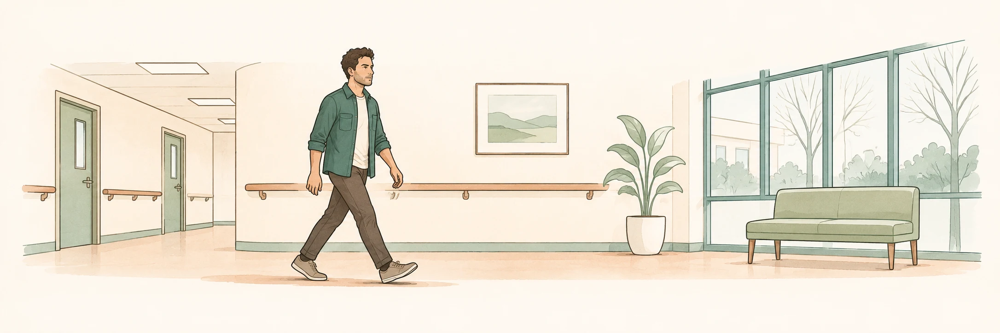
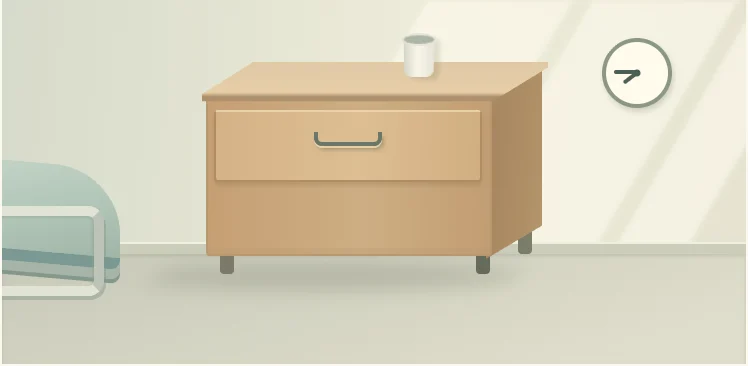
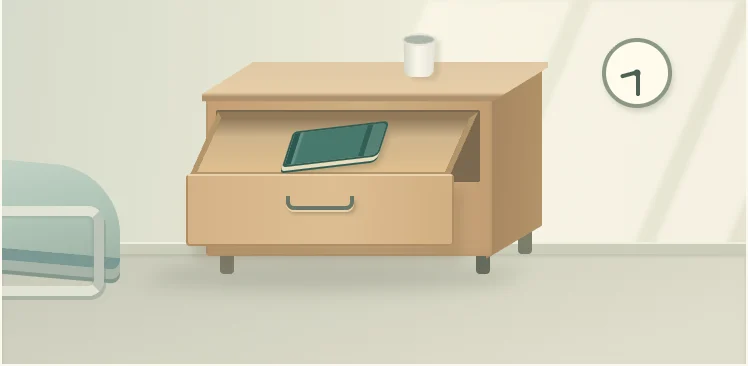

# Anxiety, OCD & Trauma on the Inpatient Unit

<figure class="fd-bedside-case" aria-labelledby="pacing-title">
  <figcaption>
    Fictional bedside case
    <strong id="pacing-title">What’s behind the pacing?</strong>
  </figcaption>
  
  
Nursing note “Pacing in the hallway. Appears anxious.”

  
MS3 prompt What would you ask the patient first?

  

    
Reveal the two cluesHide the two clues

    <dl>
      
<dt>Patient’s words</dt><dd>“I feel like I have to keep moving.”</dd>

      
<dt>Medication history</dt><dd>The antipsychotic dose was increased yesterday.</dd>

    </dl>
    
Resident follow-up What moves up your differential? What would you check before recommending a medication change on rounds?

  

</figure>

> Educational; fictional composites only, no PHI.

**In one line** — On the unit, anxiety, OCD, and PTSD are usually layered onto a primary admission diagnosis; your job is to separate the medical and substance mimics from the psychiatric disorder, choose among disorder-specific psychotherapy and medication options according to evidence, patient preference, and access, and resist the reflex to standing benzodiazepines.

**How it presents on the unit** — Pure anxiety, OCD, or PTSD rarely earns an inpatient bed on its own; you will far more often meet them riding alongside a mood episode, psychosis, or substance use disorder. Distinguish anxiety *the symptom* — a near-universal reaction to admission, withdrawal, akathisia, or an undiagnosed medical problem — from anxiety *the disorder*, which is pervasive, predates the crisis, and carries its own functional impairment. PTSD may surface as hyperarousal, nightmares, or a "behavioral" reaction to restraint, seclusion, or a same-gender vs. opposite-gender examiner. OCD can masquerade as psychosis when rituals are elaborate, or as treatment refusal when contamination fears collide with the milieu.

**Differential & can't-miss mimics** — Anxiety is a final common pathway, so screen the body first: cardiopulmonary causes (arrhythmia, PE), thyroid disease (hyperthyroidism), hypoglycemia, caffeine and stimulant intoxication, and alcohol or benzodiazepine withdrawal. On a psychiatric unit, **akathisia** is the classic miss — restless, driven motor anxiety from antipsychotics that worsens if you reflexively treat it as "agitation" with more dopamine blockade. Sudden-onset panic, chest pain, dyspnea, or autonomic instability deserves a medical workup, not reassurance.

**Initial workup** — Keep it focused and hypothesis-driven: vitals with orthostatics, a careful medication and substance history (including caffeine and recent benzodiazepine changes), and a withdrawal assessment when indicated. Order TSH, glucose/fingerstick, and a basic metabolic panel; add ECG and troponin for cardiac complaints and the PERC/Wells pathway for suspected PE. A toxicology screen helps when stimulants are plausible. Examine for tremor, the inner-restlessness of akathisia, and goiter.

<section class="bedside-case" data-ocd-drawer id="ocd-breakfast" aria-labelledby="ocd-title">

Fictional inpatient case · Morning interview

<h3 id="ocd-title">What made you go back?</h3>

Why the patient came in

“It’s four or five hours a day now, checking things. Some days I eat once. I’m still up at three going back over everything.” After weeks like this, the patient agreed to admission for help with eating and sleeping.

<button id="ocd-drawer" type="button" aria-pressed="false" aria-controls="ocd-scene-note ocd-interview" aria-label="Show the 8:30 nursing observation">
  7:45 AM45 minutes later →
  8:30 AM← Breakfast call
</button>

<b>Nursing</b>
Breakfast is called. The patient puts a notebook in the drawer and heads for the hall.

<section class="ocd-patient" id="ocd-interview" hidden aria-labelledby="ocd-ask">

At the bedside
<h4 class="ocd-ask" id="ocd-ask">“When you get to the doorway, what pulls you back?”</h4>

<button type="button" data-story="responsibility" aria-pressed="false" aria-controls="ocd-reply">First reply</button>
<button type="button" data-story="incomplete" aria-pressed="false" aria-controls="ocd-reply">Alternate reply</button>

<blockquote id="ocd-quote" tabindex="-1"></blockquote>

</section>
<section class="ocd-task" id="ocd-work" hidden aria-labelledby="ocd-map-title">

MS3 prompt
<h4 id="ocd-map-title">Map the return to the drawer</h4>

Use the patient’s words to connect the urge, the check and what happened next.

<fieldset><legend>At the doorway</legend>

<label class="ocd-opt"><input type="radio" name="ocd-before" value="fear">“What if someone sees my sister’s number?”</label>
<label class="ocd-opt"><input type="radio" name="ocd-before" value="unfinished">“I can’t leave it feeling half done.”</label>

</fieldset>

<strong>At the drawer</strong>
The patient opened the drawer and checked the notebook again.

<fieldset><legend>After checking</legend>

<label class="ocd-opt"><input type="radio" name="ocd-after" value="relief">Brief relief, then doubt about the page returned.</label>
<label class="ocd-opt"><input type="radio" name="ocd-after" value="tension">Still felt unfinished and couldn’t leave for breakfast.</label>

</fieldset>

<button class="ocd-primary" type="button" id="ocd-check">Check my map</button>

</section>
<section class="ocd-task" id="ocd-next" hidden aria-labelledby="ocd-next-title">

Resident follow-up
<h4 id="ocd-next-title" tabindex="-1">What would you ask next?</h4>

Choose a question. Use the answer for your update to the team.

<button type="button" data-question="meaning" aria-pressed="false">“Say we got halfway to breakfast. What would be going through your mind?”</button>
<button type="button" data-question="intake" aria-pressed="false">“What have you managed to eat and drink since yesterday?”</button>
<button type="button" data-question="support" aria-pressed="false">“What would help you get to breakfast this morning?”</button>

The patient
<blockquote id="ocd-answer" tabindex="-1"></blockquote>

What you can say on rounds

<button type="button" class="case-link" id="ocd-other" hidden></button>
</section>

Compare the two accounts

<b>Doubt about responsibility</b> Seeing the page settles the fear for a moment. At the door the patient doubts their own memory again.

<b>A sense of incompleteness</b> The patient knows where the notebook is. Even with it in sight, the action feels unfinished.

These experiences can overlap. In either interview, the missed meals and lost sleep matter today. Ask what the patient has taken in, check with nursing, and agree together on a way to support the next meal.

<a class="ocd-source-link" href="https://www.ncbi.nlm.nih.gov/books/NBK56460/">NICE guidance on intensive care for severe OCD</a> <a class="ocd-source-link" href="https://iocdf.org/wp-content/uploads/2014/10/Just-right-OCD-Fact-Sheet.pdf">International OCD Foundation on “just right” experiences</a>

<button type="button" class="case-link" id="ocd-reset" hidden>Start again</button>
<template data-account="responsibility" data-before="fear" data-after="relief">
“My sister’s number is on that page. What if it fell out and somebody picked it up? I open the book, see it’s still there and I can breathe. Then I get to the door and think, did I actually see it? Could you look with me?”
What does the patient imagine could happen to the page as they walk away?
The patient says they can breathe when they see the page. What changes by the doorway?

“I’d be trying to picture her number on that page. Then I’d start picking the memory apart. Was that today, or was it yesterday?”
Mentally replaying the check follows the patient into the hall. Ask about time spent on these quieter rituals, too.
The patient describes checking the page for brief relief, then mentally replaying the check on the way to breakfast.

“Some soup at lunch yesterday. By the time I got out for dinner they’d cleared it. I’ve had a few sips of water this morning. I really do want to eat.”
Tell the nurse and supervising clinician about the limited intake now so they can assess hydration and help the patient access a meal.
The patient reports soup yesterday, a missed dinner and only a few sips of water this morning. I’ll update nursing and my supervisor now.

“If you check it for me, I’ll just ask you again. Could you walk with me instead? It’d help to talk about something else on the way.”
The patient anticipates what another check would lead to and asks for company. Share that preference so staff can offer consistent support.
The patient asked for company on the walk to breakfast and expects another check would bring another request. We can offer to walk together.

</template>
<template data-account="incomplete" data-before="unfinished" data-after="tension">
“I know the book’s there. It’s like when you stop halfway through a word. I shut the drawer and it still feels half done. I open it again hoping that feeling will go. It hasn’t. I’m hungry and I’m still standing here.”
The patient knows where the book is. What do they say closing the drawer feels like?
Listen to “It hasn’t.” What is the patient still waiting to feel before they go to breakfast?

“I don’t think anything bad would happen. My hand would be itching to go back and close it properly. It’s hard to listen to anyone when it feels like that.”
The patient names a bodily urge and difficulty shifting attention. Use those words without supplying a feared event.
The patient describes a persistent unfinished feeling and a physical urge to repeat the action. They identify no feared consequence.

“Dinner was yogurt and water. The nurse sat with me. This morning I haven’t had a drink yet. My tea’s in the dining room.”
Share what the patient actually ate and drank. Check intake with nursing and help them reach food and fluids this morning.
The patient reports yogurt and water at dinner with nursing support and no fluid yet this morning. I’ll check intake with nursing.

“Give me a minute. Then could you come back and say breakfast is still there? When everyone stands in the doorway waiting, I feel rushed.”
Ask when to return and check that breakfast will still be available. A brief agreed check-in gives the patient space and a route back to the meal.
The patient asked for a minute alone and a return visit. I’ll agree on a time and confirm with nursing that breakfast can be kept available.

</template>
<template id="ocd-copy">
For 45 minutes the nurse has seen them go back and forth between the drawer and the doorway. Their breakfast is untouched.
When you asked about walking away, the patient said
When you asked about food and fluids, the patient said
When you asked about help getting to breakfast, the patient said
Fill in both ends of the map before checking it.
Your map matches this account. Choose what you would ask next.
Try the alternate reply
Return to the first reply
</template>
</section>

**Acute inpatient management** — Use disorder-specific treatment, skills, and milieu. **SSRIs are first-line medication options for anxiety disorders and OCD**; SNRIs are also first-line medication options for anxiety disorders, but not for OCD. For PTSD, prioritize individual trauma-focused psychotherapy with **cognitive processing therapy (CPT)**, **prolonged exposure (PE)**, or **eye movement desensitization and reprocessing (EMDR)**. When medication is chosen, the 2023 VA/DoD guideline recommends **sertraline, paroxetine, or venlafaxine**. Discuss preference and access when making a treatment plan; medication plus psychotherapy is not a universal requirement. Counsel patients starting an antidepressant on delayed benefit and transient early activation. **Avoid standing benzodiazepines on the unit** — they drive dependence, falls, and delirium, and are especially hazardous with comorbid SUD or in older adults; reserve them for specific, time-limited indications (e.g., a structured alcohol or sedative withdrawal protocol). Plan disorder-specific behavioral care: **exposure and response prevention (ERP)** for OCD, CPT, PE, or EMDR for PTSD, and **interoceptive exposure** for panic. During a short stay, assess acute stability and arrange access to appropriate therapy with the supervising team. Wrap all of it in **trauma-informed care** — predictability, explained procedures, offered choices, and minimized restraint/seclusion — which both reduces retraumatization and lowers behavioral escalation.

| Condition | First-line medication | Disorder-specific behavioral work |
|---|---|---|
| Anxiety disorders | SSRIs; SNRIs are also first-line | Interoceptive exposure for panic |
| OCD | SSRIs (not SNRIs) | Exposure and response prevention (ERP) |
| PTSD | Sertraline, paroxetine, or venlafaxine, when medication is chosen | Individual trauma-focused psychotherapy, prioritized: CPT, PE, or EMDR |

**Exam treatment anchors** — Panic disorder is treated first-line with an SSRI or SNRI plus CBT, especially interoceptive exposure; benzodiazepines are short-term bridges at most, not maintenance monotherapy. OCD is treated first-line with ERP and an SSRI, often at higher doses than depression; clomipramine or antipsychotic augmentation is reserved for refractory cases. PTSD care prioritizes individual trauma-focused psychotherapy with CPT, PE, or EMDR; sertraline, paroxetine, or venlafaxine are recommended when medication is chosen. The guideline recommends against benzodiazepines for PTSD and suggests prazosin specifically for PTSD-related nightmares, not for PTSD overall. Generalized social anxiety is treated with CBT/exposure and an SSRI or SNRI when medication is needed. Performance-only social anxiety is limited to discrete public performances; a PRN beta-blocker can reduce tremor, tachycardia, and sweating for those events when medically appropriate.

**When akathisia is identified** — Recognition triggers a management hierarchy; escalating the offending antipsychotic is the cardinal error. First step: **reduce the antipsychotic dose or switch to a lower-dopamine-affinity agent** (e.g., quetiapine, which has lower D2 occupancy at clinical doses) — addressing the mechanism directly is more durable than adding a second drug. When dose reduction is not immediately possible or insufficient: **propranolol 20–40 mg BID** is the usual first-line pharmacological option. Note the controlled-trial evidence is thin: the Cochrane review of beta-blockers for akathisia found only three small RCTs (n=51) and concluded the data were insufficient to recommend them (Lima et al., Cochrane Database Syst Rev 2004). This is consensus-driven practice, not a well-powered evidence base. Avoid in reactive airway disease, significant bradycardia, or heart block. If **parkinsonism co-exists** alongside the akathisia: add benztropine (anticholinergic agents target parkinsonism more reliably than pure akathisia). A **benzodiazepine** (typically clonazepam 0.5–1 mg) can provide adjunctive relief when symptoms remain severe after propranolol, but is third-line specifically for akathisia. Mirtazapine 15 mg has emerging evidence from small trials. The management hierarchy — dose reduction or switch → propranolol → benztropine if parkinsonism co-exists → benzodiazepine adjunct — ensures the intervention matches the mechanism.

**What the student does**
- Screen new admissions for an anxiety, OCD, or PTSD history and document whether symptoms predate the acute crisis.
- At the bedside, evaluate restlessness deliberately: ask about an inner urge to move and inspect for akathisia before labeling a patient "anxious."
- Review the medication list and home regimen for benzodiazepine use, abrupt discontinuation, or high caffeine intake, and flag taper or withdrawal risk to the team.
- Coach one concrete skill — paced diaphragmatic breathing or grounding — and note the patient's response.
- Track target symptoms (panic frequency, ritual time, nightmares) on serial exams to gauge medication response.

**Disposition & discharge essentials** — If medication is prescribed, confirm a tolerated dose and a clear titration plan. Arrange disorder-specific follow-up, including access to ERP for OCD and a feasible plan for the patient's chosen evidence-based PTSD treatment, such as CPT, PE, or EMDR. Discuss preference and access without implying that every patient with PTSD must receive both medication and psychotherapy. Reconcile medications so no patient leaves on a new standing benzodiazepine without an explicit, time-limited rationale and taper. Give the patient and family a relapse-warning plan and crisis contacts, and communicate trauma-informed considerations to the next setting.

<!-- crisis-block -->

**High-yield pearls**
- Anxiety is a symptom before it is a diagnosis — clear the medical and withdrawal mimics first.
- Akathisia is the great inpatient impostor; treat the cause, not with more dopamine blockade.
- Akathisia management hierarchy: reduce dose or switch the antipsychotic → **propranolol** (first-line by consensus; thin trial evidence, Lima et al. Cochrane 2004) → benztropine if co-existing parkinsonism → benzodiazepine adjunct.
- SSRIs are first-line medication options for anxiety disorders and OCD; SNRIs are also options for anxiety disorders, not OCD. For PTSD, choose sertraline, paroxetine, or venlafaxine when medication is selected; benzodiazepines are not recommended for PTSD.
- Disorder-specific psychotherapy — ERP for OCD, CPT/PE/EMDR for PTSD, interoceptive exposure for panic; for PTSD, individual trauma-focused psychotherapy is preferred over medication.
- The scale to know for OCD is the **Y-BOCS** (Yale-Brown Obsessive-Compulsive Scale) — the gold-standard clinician-rated measure of OCD severity and treatment response (a symptom checklist plus 10 severity items, obsessions and compulsions scored separately).
- Trauma-informed care is clinical, not optional: predictability and choice prevent escalation.

**Pair with** — the Mental Status Exam tool (Language & Interview tab) for eliciting anxiety and trauma history without retraumatizing; the **Reflection & PIF** set (the Reflection & Identity tool) to process your own response to distressing presentations; and the **Differential Diagnosis** scaffolds for working the anxiety-mimic list systematically.

*Joshua Moss, MD | Psychiatrist · Educational; fictional composites only, no PHI. Doses here are teaching illustrations, not prescribing guidance — verify every dose and contraindication (β-blockers in asthma, bradycardia, or heart block) against current labeling and your attending.*

**PTSD guideline reference:** VA/DoD. *Clinical Practice Guideline for Management of Posttraumatic Stress Disorder and Acute Stress Disorder*, Version 4.0, June 2023. Recommendations 7–8 (pp. 35–36), 15, 18–19 and 21 (p. 37), and 32 (p. 38). [Original 2023 release, archived July 21, 2023](https://web.archive.org/web/20230721190354id_/https://www.healthquality.va.gov/guidelines/MH/ptsd/VA-DoD-CPG-PTSD-Full-CPG.pdf); [current VA-hosted edited copy](https://www.healthquality.va.gov/HEALTHQUALITY/guidelines/MH/ptsd/VA-DoD-CPG-PTSD-Full-CPG-Edited-111624-V5-81825.pdf).
