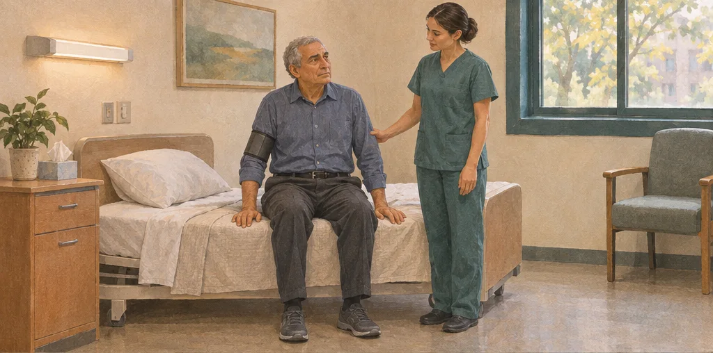
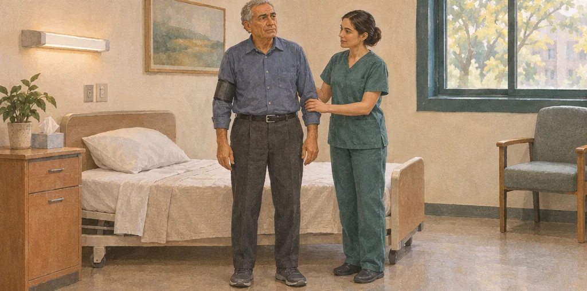

# Geriatric Psychiatry on the Inpatient Unit

> **Review status:** Reviewed and attested by Joshua Moss, MD (2026-07-09). Educational; fictional composites only, no PHI.

**In one line** — On the geriatric inpatient unit, your central job is to separate reversible from irreversible causes of cognitive and behavioral change, treat the treatable, and avoid iatrogenic harm from the very drugs meant to help.

**How it presents on the unit** — Older adults rarely arrive with a tidy chief complaint. Watch for late-life depression (often somatic, apathetic, or framed as "I just want to go home"), new or worsening psychosis (which in this age group is a red flag for an organic cause until proven otherwise), agitation in the setting of dementia, and the overlapping delirium-dementia-depression triad. Functional decline, falls, poor intake, and "failure to thrive" are common admitting framings that hide a psychiatric or medical driver.

**Differential & can't-miss mimics** — The skill that defines competent geriatric psychiatry is distinguishing delirium vs dementia vs depression. Delirium is acute, fluctuating, and marked by inattention; it is a medical emergency and the can't-miss diagnosis on every confused elder. Dementia is chronic and progressive with preserved alertness early. Depression can masquerade as cognitive impairment — the pseudodementia presentation (Caine 1981), where patients say "I don't know" rather than confabulate, show effortful disengagement, and improve cognitively when mood is treated. Do not forget vascular depression (Alexopoulos 1997): late-onset depression with executive dysfunction and white-matter burden, often less responsive to monotherapy. These three states coexist; finding one does not exclude the others.

**Initial workup** — Keep it focused and bedside-anchored. Formally test attention (digit span, months-of-the-year backward, serial subtraction) — inattention reorients you toward delirium. Perform a structured cognitive screen and document a baseline. Review every medication for deliriogenic and anticholinergic load. Screen for infection (UTI, pneumonia), metabolic derangement, hypoxia, urinary retention, constipation, and pain. Collateral history is not optional; establish the true baseline and the tempo of change.

**Acute inpatient management** — Apply the Beers Criteria and assess cumulative anticholinergic burden, then actively deprescribe deliriogenic and high-risk agents. Dose with start-low-go-slow titration. Treat fall risk and orthostasis as primary safety issues, not afterthoughts — many psychotropics worsen both. Respect the antipsychotic boxed warning for dementia-related behavioral disturbance: non-pharmacologic strategies come first, and antipsychotics are used only when necessary, at the lowest effective dose, time-limited, with documented risk-benefit discussion. Capacity assessment is frequently in play (treatment refusal, disposition disputes); assess it for the specific decision at hand. For severe, treatment-resistant, psychotic, or catatonic late-life depression, ECT is effective and often well-tolerated in older adults — keep it on the table early rather than as a last resort.

<section class="bedside-case" id="duarte-posture" aria-labelledby="dp-title">
<h3 id="dp-title">What happened when you stood up?</h3>

Before breakfast, Mr. Duarte nearly fell getting out of bed. He’s back in his room. You join his nurse for a supervised blood pressure check.

<strong>At the bedside</strong>1 of 3 viewed

<button type="button" data-posture="lying" aria-controls="dp-moment" aria-pressed="true">Lying</button>
<button type="button" data-posture="sitting" aria-controls="dp-moment" aria-pressed="false">Sitting</button>
<button type="button" data-posture="standing" aria-controls="dp-moment" aria-pressed="false">Standing</button>

<figure id="dp-moment"></figure>

<template data-moment="lying">

<figcaption>
<b>Lying · after 5 minutes</b><strong>138/74</strong> <small>mmHg</small> Pulse 68

Mr. Duarte<blockquote>“I feel all right here.”</blockquote>
The nurse measures his blood pressure and pulse after he has rested flat.

</figcaption></template>
<template data-moment="sitting">

<figcaption>
<b>Sitting · edge of bed</b><strong>No reading</strong>

Mr. Duarte<blockquote>“Give me a second to get my feet under me. Okay.”</blockquote>
He sits with both feet on the floor. The nurse stays beside him. She does not take a seated pressure.

</figcaption></template>
<template data-moment="standing">

<figcaption>
<b>Standing · at 1 minute</b><strong>108/62</strong> <small>mmHg</small> Pulse 84

Mr. Duarte<blockquote>“Hang on. I feel light-headed. Can I sit?”</blockquote>
The nurse stops the check and helps him sit. The 3-minute standing reading was not taken.

</figcaption></template>

Open each position, then choose a follow-up question.

<h4>What would you ask next?</h4>
Choose the detail you want for rounds.

<button type="button" data-question="symptom" aria-controls="dp-answer" aria-pressed="false">Patient“Take me back to this morning. What did you feel when you got up?”</button>
<button type="button" data-question="witness" aria-controls="dp-answer" aria-pressed="false">Bedside RN“You were with him before breakfast. What did you see?”</button>
<button type="button" data-question="medication" aria-controls="dp-answer" aria-pressed="false">Medication nurse“Can we check what changed on last night’s medication record?”</button>

<template data-reply="symptom"><strong class="dp-source">Mr. Duarte · before breakfast</strong><blockquote>“My eyes were open, but everything went gray. I could still hear her telling me to sit. It cleared when I sat back down.”</blockquote></template>
<template data-reply="witness"><strong class="dp-source">Bedside nurse · before breakfast</strong><blockquote>“He got to his feet and reached for the table. I caught his elbow and we sat back on the bed. He answered me the whole time.”</blockquote></template>
<template data-reply="medication"><strong class="dp-source">Medication nurse · administration record</strong><blockquote>“Here it is. Last night was his first quetiapine dose. I gave it to him at nine.”</blockquote></template>

<h4 id="dp-handoff-title">Which handoff would you give on rounds?</h4>

<button type="button" data-handoff="attribution" aria-pressed="false" aria-controls="dp-feedback">BP fell from 138/74 to 108/62 on recheck. His nurse confirmed he kept answering her during the earlier episode.</button>
<template data-feedback="attribution">You heard the patient’s account. The nurse’s observations before breakfast would require asking her.</template>
<button type="button" data-handoff="supported" aria-pressed="false" aria-controls="dp-feedback">BP fell from 138/74 to 108/62 at one minute standing. He says his vision went gray before breakfast and cleared when he sat.</button>
<template data-feedback="supported">This separates what you measured on recheck from what Mr. Duarte remembers about the earlier episode.</template>
<button type="button" data-handoff="inference" aria-pressed="false" aria-controls="dp-feedback">BP fell from 138/74 to 108/62 before breakfast, when he describes his vision going gray.</button>
<template data-feedback="inference">The readings came from the later supervised check. His description gives you the timing of the visual change, but there was no pressure recorded during the near-fall.</template>

<button type="button" data-handoff="inference" aria-pressed="false" aria-controls="dp-feedback">BP was 108/62 during the near-fall, down from 138/74. The nurse caught him as he reached for the table.</button>
<template data-feedback="inference">The nurse witnessed the near-fall before breakfast. The blood pressure drop was measured later, during the supervised recheck.</template>
<button type="button" data-handoff="attribution" aria-pressed="false" aria-controls="dp-feedback">BP fell from 138/74 to 108/62 on recheck. Mr. Duarte remembers answering the nurse throughout the near-fall.</button>
<template data-feedback="attribution">Hearing him answer was the nurse’s observation. You have not asked Mr. Duarte what he remembers about that moment.</template>
<button type="button" data-handoff="supported" aria-pressed="false" aria-controls="dp-feedback">BP fell from 138/74 to 108/62 at one minute standing. The nurse says she caught his elbow before breakfast and he kept answering her.</button>
<template data-feedback="supported">This names the witness and reports the behavior she could actually observe.</template>

<button type="button" data-handoff="supported" aria-pressed="false" aria-controls="dp-feedback">BP fell from 138/74 to 108/62 at one minute standing. The medication nurse confirmed his first quetiapine dose last night, a possible contributor.</button>
<template data-feedback="supported">The first dose is confirmed. Its timing makes it worth reviewing alongside intake and other medications.</template>
<button type="button" data-handoff="inference" aria-pressed="false" aria-controls="dp-feedback">BP fell from 138/74 to 108/62 on recheck. Last night’s first quetiapine dose explains the near-fall.</button>
<template data-feedback="inference">The record establishes exposure. Timing alone cannot establish what caused his symptoms.</template>
<button type="button" data-handoff="attribution" aria-pressed="false" aria-controls="dp-feedback">BP fell from 138/74 to 108/62 on recheck. Mr. Duarte says he took his first quetiapine dose last night.</button>
<template data-feedback="attribution">The medication nurse checked the administration record and recalls giving the dose. Mr. Duarte did not supply that history.</template>

Interpret the blood pressure change

His systolic pressure fell 30 mmHg and his diastolic fell 12 mmHg within one minute of standing, with light-headedness. That supports symptomatic orthostatic hypotension. The cause still needs assessment.

The nurse helped him sit and stayed with him. Tell the supervising clinician about the near-fall and the recheck before he walks again. Review intake and recent medications with the team.

For reference, the standard check starts after five minutes lying down and includes standing readings at one and three minutes when tolerated. <a href="https://www.cdc.gov/steadi/media/pdfs/STEADI-Assessment-MeasuringBP-508.pdf">CDC measurement guide (PDF)</a>

Quetiapine can contribute to postural hypotension, especially early in treatment. <a href="https://dailymed.nlm.nih.gov/dailymed/fda/fdaDrugXsl.cfm?setid=8ae62aaf-f8c5-417f-baac-0098369ca322&amp;type=display">Prescribing information, section 5.7</a>

<footer>Fictional encounter<button type="button" data-reset class="case-link">Start again</button></footer></section>

**What the student does** —
- Test attention at the bedside daily and document fluctuation.
- Build a complete medication reconciliation and flag every Beers/anticholinergic agent for the team.
- Call family or the facility for collateral on baseline cognition and function.
- Screen for and report constipation, retention, pain, and infection signs.
- Sit with the patient unhurried — orientation, sensory aids (glasses, hearing aids), and presence are real interventions.

**Disposition & discharge essentials** — Confirm cognitive and functional baseline before discharge; clarify whether the patient can return to prior setting or needs a higher level of care. Reconcile medications again, document what was deprescribed and why, and ensure a clear taper plan for any time-limited antipsychotic. Confirm follow-up, caregiver education, and safety supports (fall precautions, supervision of meds).

**High-yield pearls**
- New psychosis in an older adult is delirium or a medical cause until proven otherwise.
- Inattention is the fingerprint of delirium — test it, don't infer it.
- "I don't know" answers and effortful disengagement suggest pseudodementia; treat the depression.
- The drug list is often the diagnosis — deprescribing is active treatment.
- Non-pharmacologic management is first-line for dementia-related agitation; antipsychotics are time-limited exceptions.

<!-- crisis-block -->

**Pair with** — the [Delirium guidance](?page=delirium.md), the <a href="tools/capacity.html" target="_blank" rel="noopener">Decisional Capacity tool</a>, and the [Differential Diagnosis scaffolds](?page=ddx.md).

*Joshua Moss, MD | Psychiatrist · Educational; fictional composites only, no PHI.*
