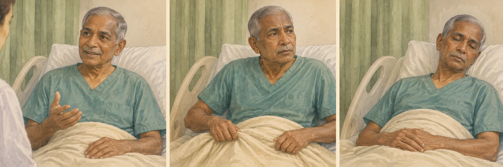

# Delirium on the Inpatient Unit

> **Review status:** Reviewed and attested by Joshua Moss, MD (2026-07-09). Educational; fictional composites only, no PHI.

**In one line.** Delirium is an acute, fluctuating disturbance of attention and awareness — a medical emergency and the great psychiatric mimic.

**How it presents on the unit.** The hallmark is a change that came on over hours to days, not weeks, and that waxes and wanes across a single shift — lucid on morning rounds, disorganized by evening. Attention is impaired, and the level of arousal is off: the patient may be hypervigilant and pulling at lines (hyperactive) or quietly drifting, slow to respond, and easy to overlook (hypoactive). The hypoactive form is the one that gets missed, and it carries worse outcomes, in part because no one is alarmed by a quiet patient. Delirium is the great mimic: in older adults especially, it is repeatedly misattributed to depression (the withdrawn, flat, hypoactive patient) or to a primary psychotic illness (the agitated, disorganized, hallucinating patient). When a patient with no psychiatric history suddenly looks "psychiatric," think delirium first.

| Form | What you see | Why it gets missed or mislabeled |
|---|---|---|
| Hyperactive | Hypervigilant, pulling at lines | The agitated, disorganized, hallucinating patient is misattributed to a primary psychotic illness |
| Hypoactive | Quietly drifting, slow to respond; withdrawn and flat | Easy to overlook and misattributed to depression; carries worse outcomes |

<section id="delirium-shift" class="fd-shift-case" aria-labelledby="delirium-shift-title">
  

    
At the bedside · Fictional case

    <h3 id="delirium-shift-title">What changed this shift?</h3>
    
A 74-year-old admitted with pneumonia. Family says he usually stays engaged in conversation. Revisit three observations from today.

  

  

    <button type="button" data-shift-time="morning" aria-pressed="false" aria-controls="delirium-shift-encounter"><strong>08:00</strong>Conversational</button>
    <button type="button" data-shift-time="midday" aria-pressed="false" aria-controls="delirium-shift-encounter"><strong>11:00</strong>Restless</button>
    <button type="button" data-shift-time="afternoon" aria-pressed="true" aria-controls="delirium-shift-encounter"><strong>15:00</strong>Quieter</button>
  

  

    
15:00 · Afternoon

    

      <dl><dt>Visible activity</dt><dd>Reclining quietly. Less restless than earlier.</dd></dl>
      <dl><dt>Attention &amp; wakefulness</dt><dd>Drifts asleep mid-sentence; needs repeated prompts to re-engage.</dd></dl>
      
The quieter appearance does not tell the whole story.

    

  

  <template data-shift-scene="morning">
    
08:00 · Morning

    

      <dl><dt>Visible activity</dt><dd>Answers questions and gestures during the conversation.</dd></dl>
      <dl><dt>Attention &amp; wakefulness</dt><dd>Follows this brief exchange.</dd></dl>
      
Family describes his usual baseline as conversational and engaged.

    

  </template>
  <template data-shift-scene="midday">
    
11:00 · Late morning

    

      <dl><dt>Visible activity</dt><dd>Shifts repeatedly in bed and looks distracted.</dd></dl>
      <dl><dt>Attention &amp; wakefulness</dt><dd>Loses the thread of a short conversation.</dd></dl>
      
This new difficulty staying engaged already warrants reporting and bedside assessment.

    

  </template>
  

    
MS3 · Make the call

    
At 15:00, which finding should lead your update?

    
Compare the observations above, then choose your opening line.

    

      <button type="button" data-shift-choice="quiet" aria-pressed="false">A“He is less restless this afternoon.”</button>
      <button type="button" data-shift-choice="attention" aria-pressed="false">B“He is now drowsy and cannot stay engaged in our exchange.”</button>
    

    

    <template data-shift-feedback-for="quiet">
<strong>That describes his movement. What changed in his engagement?</strong>

Less restlessness alone does not establish recovery. He is now drifting asleep during conversation and needs repeated prompts. Report that change and seek prompt bedside reassessment.

The inattention at 11:00 already required assessment. The 15:00 change adds a reason to reassess.
</template>
    <template data-shift-feedback-for="attention">
<strong>Lead with the change in attention and wakefulness.</strong>

Report the new drowsiness and difficulty staying engaged to your supervising clinician now. Compare with baseline and earlier observations, and seek prompt bedside reassessment.

The inattention at 11:00 already required assessment. The 15:00 change adds a reason to reassess.
</template>
    

      
Compare the two patterns across the shift

      

      <template data-shift-comparison-content>
      

        
<strong>08:00</strong>
ActivityConversational

AttentionFollows this exchange

        
<strong>11:00</strong>
ActivityRestless

AttentionLoses the thread

        
<strong>15:00</strong>
ActivityQuieter

Attention / wakefulnessDrifts asleep mid-sentence

      

      
These are observations from a fictional case, not a diagnostic score. New inattention at 11:00 already called for assessment; increasing drowsiness at 15:00 calls for reassessment.

      </template>
    

    <button type="button" class="fd-shift-case__reset" data-shift-reset>Restart case</button>
  

</section>

**Recognize and screen.** Attention is the cardinal deficit — test it deliberately rather than assuming it from conversation. Ask the patient to recite the months of the year backward, or use digit span; a patient who cannot hold the sequence is showing you the core sign. Structure the bedside impression with the **Confusion Assessment Method (CAM)** (Inouye et al.): you need acute onset *and* a fluctuating course, *and* inattention, *plus either* disorganized thinking *or* an altered level of consciousness. Walking the CAM features out loud forces you to actually look for each one instead of charting a global "confused."

  
Resident follow-up“But he knows which hospital he’s in.”

  

    
At 15:00 he correctly names the hospital, then loses the thread again. A colleague suggests checking back after dinner.

    
<strong>How would you respond, and what would you assess now?</strong>

    <label for="delirium-shift-draft">Rehearse your response</label>
    <textarea id="delirium-shift-draft" rows="3" placeholder="Name the change, explain why it matters, and choose your next assessment." aria-describedby="delirium-shift-draft-help"></textarea>
    
Fictional practice only. Your wording is not scored or saved.

    

      
Compare with one possible response

      

        
“Naming the hospital does not establish sustained attention. He has changed from his baseline and is now more drowsy. I would reassess him at the bedside now.”

        
Assess acute medical deterioration, including vital signs and oxygenation; review recent medication exposure and other possible causes. Use the local validated delirium assessment pathway. Pneumonia is one possible contributor, not a complete explanation by itself.

      

    

    
Teaching basis: <a href="https://www.safetyandquality.gov.au/clinical-care-standards/delirium">Delirium Clinical Care Standard</a>, assessment and underlying causes.

  

**Find the cause.** Delirium is a symptom; the work is finding what is driving it. Screen systematically for infection (UTI and pneumonia lead the list), metabolic and electrolyte derangements, and hypoxia. Comb the medication list for deliriogenic agents — anticholinergics, benzodiazepines, and opioids are the usual suspects — and ask explicitly about substance withdrawal. Do not forget the quiet physiologic provocateurs that are easy to fix: urinary retention, constipation, uncontrolled pain, and disrupted sleep. Often it is several of these at once.

| Where to look | What this page names |
|---|---|
| Infection | UTI and pneumonia lead the list |
| Metabolic | Metabolic and electrolyte derangements |
| Oxygenation | Hypoxia |
| Medications | Anticholinergics, benzodiazepines, opioids |
| Substances | Withdrawal — ask explicitly |
| Quiet, fixable drivers | Urinary retention, constipation, uncontrolled pain, disrupted sleep |

**Management.** Non-pharmacologic measures come **first**, not as an afterthought: reorient the patient, protect the sleep–wake cycle, mobilize early, restore sensory aids (get the glasses and hearing aids on), and bring family to the bedside. This is the work captured in the **ABCDEF** and HELP bundles. In parallel, identify and treat the underlying cause and deprescribe the deliriogenic medications you found. Antipsychotics are reserved for dangerous agitation only — lowest effective dose, time-limited — and are **not** for prevention; respect the dementia boxed warning when an older patient is involved. Avoid benzodiazepines, with the single exception of alcohol or sedative withdrawal, where they are the treatment.

**What the student does.**
- Test attention every day — months-of-the-year backward or digit span — and document the result, not a vague "alert and oriented."
- Build and maintain the medication and deprescribing list; flag every anticholinergic, benzodiazepine, and opioid for the team.
- Screen actively for infection, urinary retention, and constipation — the fixable drivers hide in plain sight.
- Secure collateral on the patient's baseline mental status so "altered" actually means altered.

**High-yield pearls.**
- Inattention is the cardinal sign — if attention is intact, reconsider the diagnosis.
- Hypoactive delirium is the dangerous one: commonly missed, worse outcomes, and easily mislabeled as depression.
- New "psychiatric" symptoms in an older medical patient are delirium until proven otherwise.
- Treat the cause and deprescribe; antipsychotics are for dangerous agitation only, never for prevention.
- Avoid benzodiazepines unless the cause is alcohol or sedative withdrawal — they otherwise deepen delirium.

**Pair with** the Differential Diagnosis scaffolds, the Geriatric page, and the agitation & restraint guidance.

*Joshua Moss, MD | Psychiatrist · Educational; fictional composites only, no PHI.*
