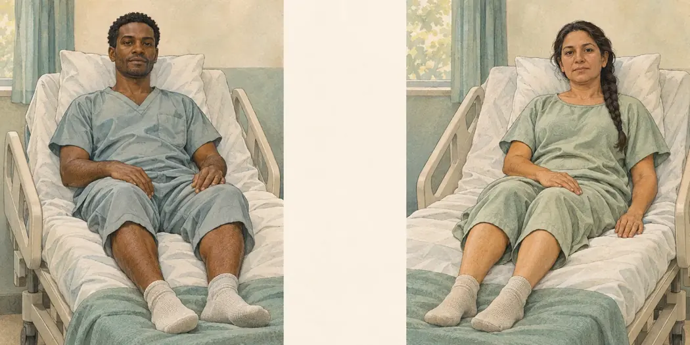

# Hyperthermia & Toxidromes: NMS, Serotonin Syndrome, Anticholinergic, Malignant Catatonia

> **Review status:** Reviewed and attested by Joshua Moss, MD (2026-07-09). Educational; fictional composites only, no PHI.

**In one line.** Four hyperthermic emergencies on the psychiatric unit share the same alarming triad — fever, altered mental status, and autonomic instability — but the neuromuscular exam, the skin, and the drug change in the last 72 hours tell them apart, and the treatments diverge sharply.

**Why this is a can't-miss.** These are the syndromes where the wrong reflex (giving an antipsychotic to a rigid, febrile patient) can kill, and where a two-second exam maneuver (checking reflexes and skin) makes the diagnosis. On any febrile, rigid, or altered patient on psychotropics, the first moves are the same: stop the likely offending agent, support and cool aggressively, and rule out infection, heat stroke, alcohol/sedative withdrawal, and stimulant toxicity — then discriminate.

**The four, side by side** — plus malignant hyperthermia, which belongs on the list because ECT is given under anesthesia.

<section class="bedside-case visual-practice fp-case" id="febrile-exam-pair" aria-labelledby="fp-case-title">
<header class="hero">
Two fictional bedside exams
<h3 id="fp-case-title">Same fever. What would you report first?</h3>

Taye and Ana are both febrile, confused and tachycardic. Select the same part of their exams to compare what the clinician finds. Pin the observation you would lead with.

<b>On the unit</b> · The emergency response is already underway for both patients. The resident asks what distinguishes their exams.
</header>
<section class="paper" aria-label="Compare Taye’s and Ana’s bedside examinations">

<strong>Taye</strong><small>38.9 °C · confused</small>

<strong>Ana</strong><small>38.9 °C · confused</small>

<button class="spot taye-arm" type="button" data-region="arm" aria-label="Compare arm tone, from Taye’s exam" aria-pressed="false">Arm</button>
<button class="spot ana-arm" type="button" data-region="arm" aria-label="Compare arm tone, from Ana’s exam" aria-pressed="false">Arm</button>
<button class="spot taye-ankle" type="button" data-region="ankle" aria-label="Compare ankle findings, from Taye’s exam" aria-pressed="false">Ankle</button>
<button class="spot ana-ankle" type="button" data-region="ankle" aria-label="Compare ankle findings, from Ana’s exam" aria-pressed="false">Ankle</button>

<strong>MS3 · Compare both exams</strong><button data-region="skin" aria-pressed="false">Skin</button><button data-region="arm" aria-pressed="false">Arm tone</button><button data-region="ankle" aria-pressed="false">Ankles &amp; reflexes</button>

Choose a finding to compare. For the time course, open the medication history or ask the bedside nurse.

<article><h3>Taye</h3>

<button class="pin" data-pin="taye" hidden>Pin Taye’s finding</button>
<button class="history" data-med="taye" aria-expanded="false" aria-controls="fp-taye-med">Medication history</button>

<button class="history" data-ward="taye" aria-expanded="false" aria-controls="fp-taye-ward">Ask the bedside nurse</button>

</article>
<article><h3>Ana</h3>

<button class="pin" data-pin="ana" hidden>Pin Ana’s finding</button>
<button class="history" data-med="ana" aria-expanded="false" aria-controls="fp-ana-med">Medication history</button>

<button class="history" data-ward="ana" aria-expanded="false" aria-controls="fp-ana-ward">Ask the bedside nurse</button>

</article>
</section>
<section class="handoff" aria-labelledby="fp-title">

Resident · Handoff to the responding team
<h3 id="fp-title">What leads your differential?</h3>

Pin one bedside finding for the patient you want to present.

Base your call on this finding and the histories you opened.

<label for="fp-lead">What do you favor now?<select id="fp-lead"><option value="">Choose an explanation…</option><option value="serotonin">Serotonin toxicity</option><option value="nms">Neuroleptic malignant syndrome (NMS)</option><option value="catatonia">Malignant catatonia</option><option value="infection">Infection-related delirium</option><option value="unsure">I need more evidence to favor one</option></select></label>
<label for="fp-rival">What else could explain this?<select id="fp-rival"><option value="">Choose an explanation…</option><option value="serotonin">Serotonin toxicity</option><option value="nms">Neuroleptic malignant syndrome (NMS)</option><option value="catatonia">Malignant catatonia</option><option value="infection">Infection-related delirium</option></select></label>

<fieldset id="fp-predictions"><legend>Which finding would most strengthen that other explanation?</legend>

Imagine the team brought back one of these updates.

<label><input type="radio" name="fp-what-if" value="cultures" data-favors="infection">Separate blood cultures grow the same pathogen as a suspected source.</label>
<label><input type="radio" name="fp-what-if" value="temperature" data-favors="">The temperature climbs and the patient is still sweating.</label>
<label><input type="radio" name="fp-what-if" value="posturing" data-favors="catatonia">Family describes episodes of mutism and sustained posturing at home, before any new medicine.</label>
<label><input type="radio" name="fp-what-if" value="clonus" data-favors="serotonin">A repeat exam shows spontaneous clonus after a confirmed serotonergic exposure.</label>
<label><input type="radio" name="fp-what-if" value="rigidity" data-favors="nms">An outside record documents similar generalized rigidity and fever after an earlier dopamine blocker.</label>

</fieldset>

<button type="button" class="primary" id="fp-commit" disabled>Discuss my reasoning</button>

<h3 id="fp-result-title"></h3>

Hear a bedside handoff
<blockquote id="fp-sample"></blockquote>

What evidence supports these distinctions?

<a href="https://pubmed.ncbi.nlm.nih.gov/12925718/" target="_blank" rel="noopener noreferrer">Dunkley et al. · Clonus and serotonin toxicity</a> The Hunter investigators identified clonus and hyperreflexia as informative in serotonergic overdoses. Applying that pattern to a ward medication interaction requires the exposure history.

<a href="https://pubmed.ncbi.nlm.nih.gov/28027111/" target="_blank" rel="noopener noreferrer">Gurrera et al. · Assessing NMS criteria</a> The authors tested a constellation of features against clinical reference criteria using archived consultations. Rigidity alone cannot settle the diagnosis.

<a href="https://pubmed.ncbi.nlm.nih.gov/1674666/" target="_blank" rel="noopener noreferrer">White and Robins · Catatonia preceding NMS</a> In five consecutive cases, catatonia was present before NMS developed. That small series shows why a history of posturing before medication matters, and why the two possibilities can coexist.

</section><footer class="casefoot">Fictional bedside teaching case<button type="button" id="fp-reset">Start again ↺</button></footer>

His forehead and the back of his gown are damp.
Tone is mildly increased in his arms. The resistance is more pronounced in his legs.
The clinician sees repeated rhythmic beats at the ankle and finds brisk leg reflexes.
Sertraline was continued. Linezolid was added this morning. The fever and movements appeared this afternoon.
“We were already treating a draining wound before he got this hot. We’re still waiting on the blood cultures.”
his skin and gown are damp
tone is higher in his legs than in his arms
he has ankle clonus and brisk leg reflexes
Sweat beads on her forehead and dampens her gown.
The clinician feels firm, uniform resistance throughout passive movement. Similar rigidity is present in her legs.
Her leg reflexes are diminished. The clinician finds no ankle clonus.
Haloperidol was started three days ago. Staff noticed progressive stiffness before today’s fever.
“Even before she got her first medicine here, she hardly spoke. She sat with one arm held in the air. The all-over stiffness came later.”
her forehead and gown are damp
she has uniform rigidity throughout passive movement in her arms and legs
her leg reflexes are diminished and there is no ankle clonus

Clonus and brisk reflexes within hours of adding linezolid to sertraline make serotonin toxicity a strong working diagnosis.

Clonus and brisk reflexes put serotonin toxicity high on the list. Check the medication timeline for a serotonergic exposure.

The timing of linezolid with sertraline raises concern for serotonin toxicity. Clonus and reflexes would carry more weight than the pinned finding alone.

Diminished reflexes without clonus give less support to serotonin toxicity. Ask what changed on the medication list.

Uniform whole-limb rigidity gives less support to serotonin toxicity. Look for clonus and establish any serotonergic exposure.

Fever and confusion fit serotonin toxicity, but the pinned finding alone gives little leverage. Check clonus, reflexes and medication timing.

Progressive, generalized rigidity after starting haloperidol makes NMS a strong concern.

The haloperidol start and progressive stiffness make NMS a concern. The distribution and quality of tone help judge it.

Uniform generalized rigidity fits NMS. Establish whether it followed dopamine blockade and when the fever began.

Clonus with brisk reflexes weighs against NMS as the best explanation. A dopamine-blocker exposure and the course of rigidity would matter.

Fever and confusion alone give limited support to NMS. Look for progressive generalized rigidity and a relevant medication change.

Mutism and sustained posturing before ward medication make catatonia a serious possibility. With fever and tachycardia, consider malignant progression alongside possible superimposed NMS.

Mutism and sustained posturing before ward medication make catatonia a serious possibility. With fever and tachycardia, consider malignant progression and clarify the later medication exposure.

Look for mutism, posturing or other catatonic signs before the fever or drug change. The pinned finding alone cannot establish malignant catatonia.

The draining wound keeps infection in the differential while cultures are pending. Infection could contribute to delirium while a second process explains the clonus.

The draining wound keeps infection in the differential while cultures are pending. An infectious source does not settle the cause of the neurologic findings.

Fever, tachycardia and delirium warrant a parallel search for infection. A focal source and matching cultures would strengthen that explanation.

You can keep the diagnosis provisional while naming what leads. Clonus with brisk reflexes already shifts the balance toward serotonin toxicity, particularly with the medication timeline you opened.

You can keep the diagnosis provisional while naming what leads. Clonus with brisk reflexes already shifts the balance toward serotonin toxicity. Confirm recent exposures.

You can name NMS as a leading concern from the post-haloperidol rigidity while keeping room for alternatives, especially the earlier posturing and mutism.

You can name NMS as a leading concern from the post-haloperidol rigidity while keeping room for alternatives. Ask what preceded the first dose.

Keeping the differential open is defensible. Which would change your ranking most — the time course, a specific exposure or the neuromuscular exam?

Matching blood and source cultures would support an invasive infection, which could coexist with a drug reaction.

A higher temperature increases urgency. Sweating and fever occur across these diagnoses and do little to separate them.

Catatonic signs before the new medication would raise concern for a catatonic illness, even if a drug reaction followed.

Spontaneous clonus after a serotonergic exposure would move serotonin toxicity up the list.

A prior similar episode after dopamine blockade would add weight to NMS. The timing and exam in the current episode still matter.

Nursing saw mutism and sustained posturing before the first ward medication.
Nursing reports a draining wound. Blood cultures are pending.
We’re also evaluating infection.

Serotonin toxicity is high on my list.

Serotonin toxicity is high on my list. I need to confirm recent serotonergic exposure.

I’m concerned about a catatonic illness with possible superimposed NMS. I’d reconstruct when the rigidity spread relative to the first dose.

I’m concerned about NMS. I’d ask about speech and posturing before the first dose.

Malignant catatonia is a concern. I’d establish what medication she received and when.

Serotonin toxicity is a concern. I’d check clonus and reflexes.

Sweating doesn’t narrow this enough. I’d check tone and reflexes and clarify the medication timeline.

I’d clarify the timing of medication changes before favoring a drug syndrome.

</section>

| | Offending agent | Onset | Neuromuscular | Skin / pupils | CK | First move beyond supportive |
|---|---|---|---|---|---|---|
| **NMS** | Dopamine blocker started/increased (or dopamine agonist withdrawn) | Days | **Lead-pipe rigidity, hyporeflexia** | Diaphoretic | Very high | Stop antipsychotic; benzodiazepine; dantrolene or bromocriptine; ICU |
| **Serotonin syndrome** | Serotonergic agent added/increased (SSRI, SNRI, MAOI, tramadol, linezolid, triptans, methylene blue) | Hours | **Clonus + hyperreflexia (legs > arms)**, tremor, myoclonus | Diaphoretic, **mydriasis**, hyperactive bowel | Mild–moderate | Stop agent; benzodiazepine; cyproheptadine |
| **Anticholinergic toxicity** | Anticholinergics (diphenhydramine, TCAs, benztropine, antihistamines) | Hours | Normal reflexes, no clonus | **Dry, flushed skin; mydriasis; urinary retention; absent bowel sounds** | Normal | Supportive; benzodiazepine for agitation; physostigmine in select severe cases |
| **Malignant catatonia** | Underlying catatonia (may have *no* recent antipsychotic) | Days | **Rigidity, waxy flexibility, posturing, mutism** | Diaphoretic | Variable | Stop antipsychotics; benzodiazepine (lorazepam challenge); **ECT is definitive** |
| **Malignant hyperthermia** *(the anesthesia-room mimic)* | Volatile anesthetics or succinylcholine in a susceptible patient (RYR1 variant) — in or after anesthesia, **including ECT** | Minutes to hours | Rigidity; **rising end-tidal CO₂**; hyperkalemia | Flushed, diaphoretic | Rises (rhabdomyolysis) | Anesthesia emergency: stop the trigger; **dantrolene**[^rosenberg-2015-malignant-hyperthermia] |

**The discriminators that actually decide it.**
- **Lead-pipe rigidity + hyporeflexia → NMS.**[^strawn-2007-neuroleptic-malignant-syndrome]
- **Clonus + hyperreflexia, worse in the legs → serotonin syndrome.**[^boyer-shannon-2005-serotonin-syndrome]
- **Dry, flushed skin + mydriasis + urinary retention → anticholinergic toxicity** (serotonin syndrome is *wet*; anticholinergic is *dry* — "dry as a bone").
- **Waxy flexibility/posturing, especially without a clear drug trigger → malignant catatonia** (NMS and malignant catatonia overlap so much that many regard NMS as a drug-induced malignant catatonia; the shared imperative is to stop antipsychotics).

**What the student does.**
- On any febrile, rigid, or altered patient on psychotropics: check reflexes (hypo vs. hyper/clonus) and skin (dry vs. diaphoretic), and review the medication history, especially every change in the last 72 hours (NMS can still arise weeks into a stable dose) — that history usually names the syndrome.
- Hold the antipsychotic and escalate immediately; do not reach for another antipsychotic to "calm" a rigid febrile patient.
- Send a CK, and support aggressively (cooling, fluids, monitoring) while the workup proceeds.

**High-yield pearls.**
- The medication history — especially changes in the last 72 hours, though NMS can arise after weeks on a stable dose — usually names the syndrome; always reconstruct it.
- Hyporeflexia points to NMS; hyperreflexia and clonus point to serotonin syndrome.
- Never give an antipsychotic in NMS or malignant catatonia — antipsychotics are the problem, not the treatment.
- ECT is the definitive treatment for malignant catatonia (and for NMS-catatonia overlap).[^bap-catatonia-2023]
- Cyproheptadine is the antidote-of-choice for serotonin syndrome; dantrolene/bromocriptine for NMS; benzodiazepines help NMS, serotonin syndrome, and catatonia alike.

**Pair with** Catatonia (and the Bush-Francis scale), Agitation & Restraint, the Psychopharmacology Primer, and Delirium.

*Joshua Moss, MD | Psychiatrist · Educational; confirm agents/antidotes against current references and institutional protocol; fictional composites only, no PHI.*
