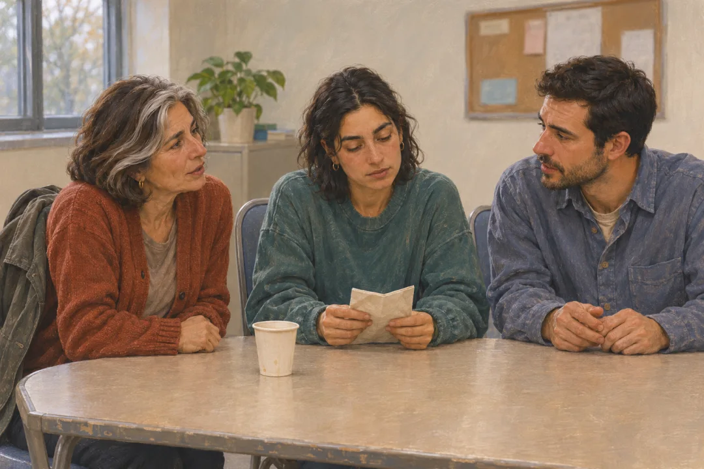

# Family Therapy Modalities Commonly Used Inpatient

> **Source:** adapted from Dr. Moss's Family Therapy Inpatient Didactic ("The Toolbox" slide). Educational; fictional composites only, no PHI.

**The frame:** most inpatient family work is **brief, psychoeducational, and systemic** — you rarely complete therapy on the unit. The goal is to *start the work and secure the handoff.* Knowing the toolbox lets you **match the modality to the family** in front of you.

## The toolbox — match the tool to the family

| Modality | Core moves | Best inpatient use |
|---|---|---|
| **Family psychoeducation / multifamily groups** *(McFarlane)* | Structured illness education + coping & communication skills | The default, highest-evidence approach — start illness education and a shared warning-signs plan |
| **Behavioral family therapy** *(Falloon)* | Communication + problem-solving skills training; lowers expressed emotion | Coach one concrete communication or problem-solving skill before discharge |
| **Structural** *(Minuchin)* | Realign roles, subsystems, and boundaries; use enactment | Re-clarify roles when a parent/partner is over- or under-functioning |
| **Bowenian / intergenerational** | Differentiation, triangles, over-/under-functioning; genogram-driven | A quick genogram to see the pattern across generations and triangles |
| **Emotionally Focused Therapy (EFT)** *(Johnson)* | Attachment-based; de-escalate the negative cycle, rebuild the bond (couples) | Name and soften the pursue–withdraw cycle in a distressed couple |
| **CRAFT** (Community Reinforcement & Family Training) | The family changes its **own** behavior to invite treatment — no blame | Substance use: give the family concrete, blame-free moves that pull toward care |
| **CBT-informed / reduce accommodation** *(SPACE; ERP)* | Coach the family to stop accommodating anxiety/OCD; support graded exposure | Anxiety/OCD: identify and dial back family accommodation |
| **DBT-informed family skills** | Validation + limits; reduce invalidation; manage high-intensity dyads | Borderline-pattern crises: pair validation with consistent limits |
| **Solution-focused / single-session** | Amplify existing strengths in one high-yield consultation | When you get only one meeting — make it count on strengths and next steps |
| **Open Dialogue / network meetings** | Rapid, transparent network meetings during acute crisis | First-episode/crisis: convene the network early and transparently |

*Also commonly cited for bipolar maintenance: **Family-Focused Therapy (Miklowitz)** — psychoeducation + communication + problem-solving, mood-stabilizing alongside medication.*

<section id="leah-family" class="bedside-case" aria-labelledby="lf-title">
<h3 id="lf-title">Who gets put in the middle?</h3>
    
At a discharge planning meeting, the resident asks where Leah might spend her first night out of the hospital. Last week, when Leah stopped answering her phone, Mom let herself into Leah’s apartment with her spare key.

    
Same meeting, two ways it can go
<button type="button" data-version="a" aria-label="Conversation A" aria-pressed="true">A</button><button type="button" data-version="b" aria-label="Conversation B" aria-pressed="false">B</button>

    <section class="map-card" aria-label="Family conversation map">
      
<strong>Tap to replay each person’s words</strong>0 of 3 heard

      

        
        

          <button data-person="mother" type="button" aria-pressed="false" aria-controls="lf-voice"><i aria-hidden="true"></i>Mom</button>
          <button data-person="patient" type="button" aria-pressed="false" aria-controls="lf-voice"><i aria-hidden="true"></i>Leah</button>
          <button data-person="brother" type="button" aria-pressed="false" aria-controls="lf-voice"><i aria-hidden="true"></i>Dan</button>
        

      

      

At the table

Mom turns to Dan, Leah’s brother. “Should I put sheets on the pullout?”

      

        <h4 id="lf-route-label">Who’s answering whom?</h4>
        
QuestionMom→ then Dan

        
ResponseListen around the table

      

    </section>
    <section class="invitation" aria-labelledby="lf-invite-title">
      <h4 id="lf-invite-title">What would you say next?</h4>
      
Replay the three voices to join the conversation.

      <button type="button" id="lf-ask-brother" aria-controls="lf-brother-clarification" aria-expanded="false" disabled>“Dan, what did you two talk about last night?”</button>
      <blockquote id="lf-brother-clarification" class="clarification" tabindex="-1" hidden>Dan
“She said, ‘I don’t want to walk into an empty apartment.’ The pullout was my idea. I never asked if she wanted it.”
</blockquote>
      <button type="button" id="lf-invite" aria-controls="lf-preference" aria-expanded="false" disabled>“Leah, what do you think? Want to tell your mom, or would it help if Dan started?”</button>
      

    </section>
    <section id="lf-handoffs" aria-labelledby="lf-handoff-title" hidden>
      <h4 id="lf-handoff-title">The nurse asks, “What did you work out?”</h4>
      

        <button type="button" data-handoff="assumed"></button>
        <button type="button" data-handoff="direct"></button>
        <button type="button" data-handoff="supported"></button>
      

      

      

        <h4>Handoff for rounds</h4>

        

Where’s the triangle?

      

    </section>
    <footer>Fictional teaching case<button type="button" id="lf-reset">Start again</button></footer>
<template data-family-accounts>
Mom
“Should I put sheets on the pullout? Dan, you talked to her last night. Is she coming to mine?”
Dan · brother
“I told Mom you probably would. You called me at eleven and said you didn’t want to go back to an empty apartment.”
Leah · patient
“Dan, I called because I couldn’t sleep. Now Mom’s making up the couch.”
There’s a pause. You have time for a question.
Dan has told you what he remembers. Leah is still sitting across from you.
You turn back to Leah.
Dan says the pullout was his idea
Dan thinks she’ll stay with Mom
</template>
<template data-family-version="a" data-match="direct">

<blockquote>Leah
“I’ve got it, Dan. Mom, could I stay with you the first night? Just the one. I want to go back to my place the next day.”
</blockquote>
<blockquote>Mom
“Yeah, honey. One night’s fine. Just let me know when they say you can leave.”
</blockquote>

Leah→ then Mom→ then Leah

Leah will stay with Mom the first night. Mom will pick her up when the unit calls.
Leah asked to stay one night and Mom said yes. We still need to sort out how she’ll get there.
Mom offered the pullout. Dan is going to check whether Leah wants to take her up on it.
“One night’s fine” answers Leah’s request. Nobody offered a ride or named a discharge date.
Mom said to let her know when Leah can leave. Did she say she could come get her?
Listen to the last two turns. Leah asked Mom herself, and Mom answered her.
Leah asked Mom if she could stay the first night after discharge. Mom said yes to one night. We still need to confirm the ride and discharge date.
Mom went to Dan because he had talked to Leah the night before. His account helped explain the offer. Leah’s own request and Mom’s answer are what let you put one night at Mom’s in the handoff.
</template>
<template data-family-version="b" data-match="supported">

<blockquote>Leah
“Dan, can you start? The thing with the key. I keep trying to say it and we end up fighting.”
</blockquote>
<blockquote>Dan
“Mom, when you used the spare key last week, it freaked her out.”
</blockquote>
<blockquote>Leah
“Yeah. Mom, call me first, okay? Give me a chance to get the door. I don’t know yet where I want to sleep.”
</blockquote>
<blockquote>Mom
“I was scared, honey. You hadn’t picked up in two days.”
</blockquote>

Dan starts→ then Leah addresses Mom

Leah and Mom agreed that Mom will call before using the key. The first night is still up in the air.
Leah wants to go back to her apartment. She asked Mom to call first and give her time to get the door.
Leah asked Dan to bring up the key, then told Mom what she wanted. She hasn’t picked where she’ll stay.
Leah did ask Mom to call. Her next sentence was “I don’t know yet where I want to sleep.”
Leah made that request. Mom explained why she used the key. You haven’t heard her agree to a plan yet.
Dan helped with the part Leah asked him to start. Leah made the request herself and left the first night open.
Leah asked Dan to start the conversation about the spare key. She then asked Mom to call first and give her time to answer the door. We haven’t heard Mom agree to that yet. Where Leah will stay the first night is still open.
Dan spoke twice for different reasons. Early on he guessed what Leah wanted. Later she asked him to help start a hard conversation and then spoke for herself. That distinction matters when the team decides whom to ask next.
</template>
</section>

## Why it's worth the friction — the evidence in numbers
- **OR 0.18** — family psychoeducation led 11 models for 12-month relapse prevention (Rodolico et al., *Lancet Psychiatry* 2022; 90 RCTs, >10,000 patients). **Dose matters:** ≤2 sessions is ineffective; NICE recommends ≥10 sessions over ≥3 months.
- **NNT 7** — treat seven families to prevent one relapse (Pharoah, *Cochrane* 2010; the relapse estimate pools 32 of its 53 RCTs).
- **OR 0.56 (95% CI 0.43–0.74)** — in bipolar disorder, adjunctive manualized psychotherapies reduced recurrence vs. control; **psychoeducation delivered in a family or group format reduced recurrence relative to the same content delivered individually (OR 0.12, 0.02–0.94)**, and **family/conjoint therapy was associated with better retention than standard psychoeducation (OR 0.46, 0.26–0.82)**; its effect on depressive symptoms was uncertain (SMD −0.46, CI crossing zero) (Miklowitz et al., *JAMA Psychiatry* 2021; 39 RCTs) — the evidence anchor for Family-Focused Therapy above.
- **≈ 3×** — family involvement during admission nearly triples the odds of 7-day follow-up (Haselden 2019).
- **Reaches a minority of families** — structured family work is delivered in only ~0–53% of cases (historically <10%), and the main barrier is **clinician avoidance, not patient refusal** (Dixon 1999; Eassom 2014).
- **Expressed emotion:** high-EE roughly **quintuples the odds of relapse within 12 months (OR ~4.87; ~2-fold for later relapse, OR 2.13)**, while family *warmth* is protective (OR ~0.35) (Ma et al. 2021, 33 cohorts); Butzlaff & Hooley (*Arch Gen Psychiatry* 1998) established the EE–relapse link. Family climate is *modifiable* — meetings help lower it.

## The stance that makes any modality work
Multipartiality over neutrality ("not a courtroom; multiple truths") · the **translator** role (structure ↔ control; anger ↔ fear) · a **de-shaming** lens (behavior as regulation, not character) · coach **influence, not control**. With an acutely psychotic patient, keep it brief, concrete, low-stimulation — interpretation waits.

**Pair with** the **[Family Meeting Playbook (90-min)](?page=family_playbook.md)** and the expressed-emotion teaching in the Family & Relational material, and Week 4 of the curriculum.

*Joshua Moss, MD | Psychiatrist · Adapted from the Family Therapy Inpatient Didactic. Educational; fictional composites only, no PHI.*
